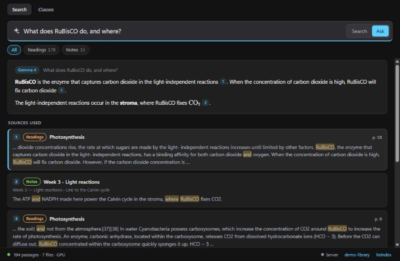
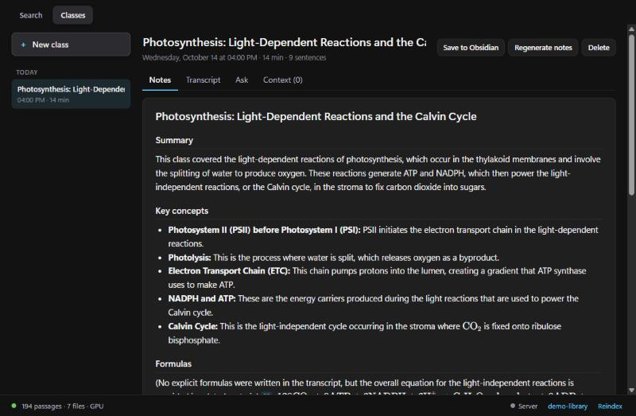
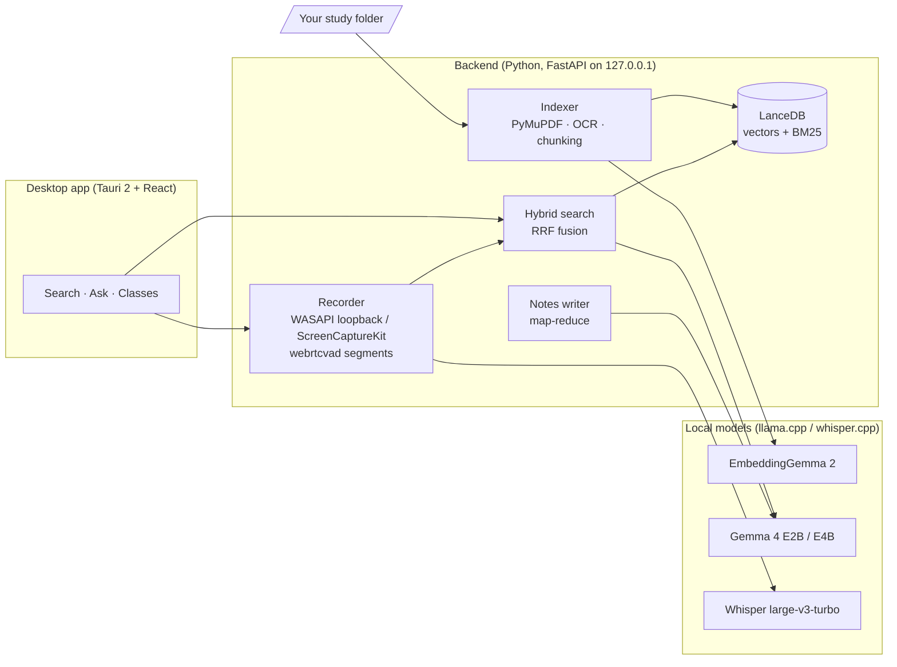

# Foresight

**A private study assistant that runs on your own computer.** Point it at the folder with your
course materials (PDFs, Markdown notes, an Obsidian vault) and it gives you:

- **Semantic search** over everything, in any language, that opens the PDF *at the right page*.
- **Answers with citations** from Gemma 4, grounded only in your materials.
- **Class recording**: live transcription of an online class (Zoom, Meet, Teams…), cards from
  your library while the teacher talks, and structured notes when the class ends.

Nothing leaves the machine: the models run locally on [llama.cpp](https://github.com/ggml-org/llama.cpp)
and [whisper.cpp](https://github.com/ggml-org/whisper.cpp). It works for any subject; a small
**study profile** (a JSON file) tunes prompts, transcription and filters to yours.





<sub>Screenshots use a demo library of Wikipedia articles (CC BY-SA) and the sample notes of a
made-up class.</sub>

## Features

**Search** (`Ctrl+1`)
- Hybrid retrieval: vector search with EmbeddingGemma 2 (meaning, across languages) fused with
  BM25 keyword search (acronyms, exact terms) via Reciprocal Rank Fusion. ~150 ms per query.
- Results show the book, page and chapter; click to open the PDF at that page (SumatraPDF,
  Acrobat or Edge on Windows; Skim or Preview on macOS) or the note in Obsidian.
- **Ask** mode: the best passages go to Gemma 4, which answers with clickable `[n]` citations
  and renders formulas with KaTeX.
- Filters by collection: each top-level subfolder of your library becomes one, or the profile
  defines them.
- Scanned PDFs are read with the system's OCR (Windows.Media.Ocr / Apple Vision).
- Incremental index: only new or changed files are processed; identical files are indexed once.

**Classes** (`Ctrl+2`)
1. *New class* → record the computer's audio (the online class), your microphone, or both.
2. While it runs:
   - live transcript with Whisper large-v3-turbo (sentence by sentence, ~1 s after each pause);
   - **quick notes**: jot down ideas, each line keeps the minute it was written;
   - **context cards**: every ~12 s, what is being explained is searched in your library and
     shown with the exact page;
   - optional **live answers** when someone asks a question in class.
3. *Stop and create notes* → Gemma 4 writes a summary, key concepts, formulas, worked examples,
   *your quick notes expanded* with what the teacher said at that minute, exam tips, homework and
   what to review (citing your materials). Long classes are summarised in parts first.
4. Afterwards: play the audio from any minute, **ask about the class** ("what homework was
   set?") and **save to Obsidian** (or to a `Classes/` folder) so it becomes searchable too.

**Server mode**: a computer that can't run the models (e.g. an Intel Mac) uses the ones on your
PC over [Tailscale](https://tailscale.com), while its files and index stay on it.

## How it works



- **Chunking.** PDFs are split per page into ~220-word passages with overlap; running headers and
  footers are dropped, and each passage is tagged with its chapter from the PDF outline. Markdown
  is split by headings.
- **Models.** Two `llama-server` processes (embeddings and chat) and one `whisper-server`, started
  and stopped by the backend. Gemma 4 E2B is the fast default; E4B can be picked for quality, and
  the app swaps back to E2B while recording so Whisper fits in VRAM.
- **Notes.** A short class goes to Gemma whole; a long one is summarised in parts (map), condensed
  until it fits the context window (reduce), and the per-part notes are kept below the summary.
- **Process model.** The Tauri shell starts the backend and ties its lifetime to the app (a Windows
  job object; a process group plus a parent watchdog on macOS), so closing the app frees the GPU.

## Requirements

**Windows 10/11 (x64)**, the full app:
- An **NVIDIA GPU with 4 GB+** is recommended. Without one, search and answers run on the CPU
  (slower), and live transcription isn't practical.
- ~5.5 GB of disk for models and runtimes (+5 GB for the optional E4B model), plus ~2 GB of build
  files.
- To build: [uv](https://docs.astral.sh/uv/), [Node.js LTS](https://nodejs.org) and
  [Rust](https://rustup.rs) (with the MSVC build tools).

**macOS 13+**, as a client of a Windows PC running Foresight in server mode (the Mac indexes
and searches its own files; the PC computes embeddings, answers and transcribes). Building needs
Xcode's Command Line Tools as well as uv, Node and Rust.

## Install (Windows)

```powershell
git clone https://github.com/usertores/foresight.git
cd foresight
powershell -ExecutionPolicy Bypass -File scripts\setup.ps1   # runtimes + models (~4.9 GB)
cd backend; uv sync
cd ..\app; npm install; npm run tauri build
```

`setup.ps1` takes `-Quality` (also download Gemma 4 E4B) and `-NoClasses` (skip Whisper). The
installer ends up in `app\src-tauri\target\release\bundle\nsis\`. On first launch the app asks for
the folder with your materials and indexes it.

The built app starts the backend from this repository (`backend\.venv`), and `data\`,
`config.json`, `models\` and `runtime\` live here too, so keep the repository where it is.

## Study profiles

A profile adapts Foresight to a subject. Pick one in `config.json` at the repository root:

```json
{ "profile": "profiles/cfa-level-1.json" }
```

| Field | What it does |
|---|---|
| `subject` | Name used in prompts and in the interface ("CFA Level I"). |
| `context` | One or two sentences added to every prompt ("The student is preparing for…"). |
| `language` | Default language of recorded classes (`en`, `es`, … or `auto`). Notes are written in the class's language; answers follow the language of the question. |
| `vocabulary` | Terms that bias Whisper towards the subject's jargon. |
| `sources` | Filter labels: `{ "label": "Mocks", "match": ["mock"] }` labels files whose top folder or name contains "mock". First match wins. |
| `examples` | Example questions shown on the empty search screen. |

Without a profile Foresight is subject-agnostic: Markdown files are *Notes* and every other file
takes the name of its top-level folder as its filter. See [`profiles/`](profiles) for two examples
(CFA Level I and Organic Chemistry).

## Usage

| Key | Action |
|---|---|
| `Ctrl+Shift+Space` | Show/hide the window from anywhere |
| `Enter` | Search (or ask, depending on the mode) |
| `Ctrl+Enter` | Ask Gemma 4 |
| `Tab` | Switch between Search and Ask |
| `↑` `↓`, `Alt+Enter` | Move through results, open the selected one |
| `Esc` | Cancel → clear → hide |
| `Ctrl+1` / `Ctrl+2` | Search / Classes |

On macOS use `⌘` for `Ctrl` and `⌥` for `Alt`. Closing the window hides it to the tray;
**Quit** in the tray menu stops everything and frees the GPU. The folder name in the status bar
changes the indexed folder; **Reindex** picks up changes right away.

A class hour takes ~115 MB of audio per source, in `data/meetings/<id>/` with the transcript,
quick notes and notes. Make sure you are allowed to record the classes you attend.

## Server mode (use the models from another computer)

1. Install Tailscale on both computers and sign in with the same account.
2. On the PC: status bar → **Server** → *Serve models to my other computers*; copy the address
   and password.
3. On the other computer, the first launch shows **Connect to your PC**: paste them and pick the
   study folder (saved in `config.json` as `remote_url` / `remote_token`).

How it is protected:
- **Off by default.** When off, the app only listens on `127.0.0.1`.
- When on, a separate server (port 8770) listens **only on the PC's Tailscale address** and every
  request needs the password; regenerating it revokes the old one at once.
- It exposes **only the models** (`/v1/health`, `/v1/embed`, `/v1/chat/completions`,
  `/tokenize`, `/v1/ocr`, `/v1/class/*`, `/v1/transcribe`), never the app's API, which can open
  files and programs.
- One class at a time across both machines; a remote class that stops sending audio is closed
  after 5 minutes. While it is on, the PC doesn't sleep when idle (closing the lid still does).

## macOS client

```bash
cd backend && uv sync
cd ../app && npm install && npm run tauri build
cp -R "src-tauri/target/release/bundle/macos/Foresight.app" /Applications/
```

- System audio is captured with ScreenCaptureKit through a small Swift helper
  (`backend/src/foresight/syscap.swift`), compiled on first use (needs Xcode's Command Line
  Tools). The first class asks for the *Screen & System Audio Recording* permission.
- PDFs open at the page in [Skim](https://skim-app.sourceforge.io) if it is installed; with
  Preview the app drives *Go to Page* (it asks for the Accessibility permission once).
- Scanned pages are OCR'd on the PC when it is reachable (~0.1 s/page against ~2.4 s with
  Apple Vision on an Intel Mac).
- Intel Macs get `lancedb 0.25.3`, the last release with Intel wheels.

## Configuration

`config.json` at the repository root overrides the defaults in
[`backend/src/foresight/config.py`](backend/src/foresight/config.py), e.g.:

```json
{
  "corpus_dir": "D:/Study/Biology",
  "profile": "profiles/organic-chemistry.json",
  "chat_model": "models/gemma-4-e4b-it-qat.gguf",
  "device": "none"
}
```

`device` is `auto` (the NVIDIA GPU if llama.cpp sees one) or `none` (CPU). `FORESIGHT_CONFIG`
points the backend at another config file, handy for a second instance on other ports.

## Development

```bash
cd backend
uv run foresight index                 # index the folder (incremental; --force rebuilds)
uv run foresight search "krebs cycle" -s Notes
uv run foresight ask "What does RuBisCO do?"
uv run foresight serve                 # API on http://127.0.0.1:8765

cd app
npm run tauri dev                      # the app with hot reload
```

```
backend/   Python (uv): extraction, LanceDB index, hybrid search, class recording and notes,
           FastAPI on :8765, server-mode gateway on :8770
app/       Tauri 2 + React: UI, global shortcut, tray; starts the backend
profiles/  study profiles (JSON)
scripts/   setup.ps1: runtimes and models
runtime/   llama.cpp, whisper.cpp       ← downloaded, not versioned
models/    GGUF / GGML model files      ← downloaded, not versioned
data/      index, classes and logs      ← not versioned
```

## Measured performance

On a laptop with an RTX 3050 (4 GB) and an i7-12650H, with a library of ~16,500 PDF pages:

| | |
|---|---|
| Full index (16,462 pages → 21,000 passages) | ~12 min, once; incremental afterwards |
| OCR of scanned pages (Windows.Media.Ocr) | ~0.1 s/page |
| Search | ~150 ms |
| Gemma 4 E2B | ~2,100 tok/s reading context, ~70 tok/s writing; first word in 1–3 s |
| Gemma 4 E4B | doesn't fit in 4 GB: ~6 tok/s ("quality" mode) |
| Whisper large-v3-turbo (CUDA 12.4) | ~40× real time; 0.3–1 s per sentence |
| Notes of a short class / a 1 h class | ~15 s / ~1 min |
| VRAM with the three models (recording) | ~3.7 of 4 GB; Whisper is unloaded afterwards |

## Notes

- **No Ollama needed**: llama.cpp is used directly (Vulkan build), which also runs EmbeddingGemma 2.
- Whisper uses whisper.cpp's **CUDA 12.4** build: the 11.8 build lacks cuBLAS and falls back to the
  CPU (30 s per 38 s of audio instead of 1 s).
- Ideas for later: telling speakers apart within the class audio (it now separates only *Class*
  and *Me*), local models on Apple Silicon, and a self-contained installer.

## License

The code is [MIT](LICENSE). The models are downloaded separately and keep their own licenses:
Gemma 4 and EmbeddingGemma 2 (Apache 2.0), Whisper (MIT).

Inspired by Google AI Edge Foresight. This is an independent project, not affiliated with or
endorsed by Google.
